# HOSPkart Hospital CRM & Sales Ops — complete project guide

**With QuoteSaarthi, Excel invoice analysis, calling, feedback and messaging workflows.**

This companion to [README.md](README.md) explains the implemented application for business users, managers, developers and presentation audiences. Use [PPT_GENERATION_PROMPT.md](PPT_GENERATION_PROMPT.md) to generate a detailed presentation from this guide and its screenshots.

Documentation prepared on **12 October 2026**. All screenshots use **synthetic demonstration records**, a synthetic invoice workbook and a four-offer test catalogue. Screenshot totals are examples, not HOSPkart business results. No customer messages were sent. The capture process used a temporary database and fresh browser profile, without changing the live dashboard.

## Contents

1. [Purpose and scope](#purpose-and-scope)
2. [Navigation and workspaces](#navigation-and-workspaces)
3. [Dashboard and metric definitions](#dashboard-and-metric-definitions)
4. [Workspace walkthrough](#workspace-walkthrough)
5. [Calling, feedback and messaging](#calling-feedback-and-messaging)
6. [Excel import and invoice reporting](#excel-import-and-invoice-reporting)
7. [Backups and admin removal](#backups-and-admin-removal)
8. [QuoteSaarthi](#quotesaarthi)
9. [Architecture and data ownership](#architecture-and-data-ownership)
10. [Setup and production operation](#setup-and-production-operation)
11. [Testing, training and troubleshooting](#testing-training-and-troubleshooting)
12. [Limitations and proposed improvements](#limitations-and-proposed-improvements)
13. [Screenshot inventory and presentation instructions](#screenshot-inventory-and-presentation-instructions)

## Purpose and scope

Hospital sales teams often maintain hospital contacts, quotations, purchase requirements, follow-up notes and invoice files in separate places. This project brings those operational workflows into one web interface while keeping independent workspace records identifiable.

The application helps a user answer: Which hospital needs contact? What requirement was recorded? Which quotation needs follow-up? Which invoice belongs to which client? What was the last call outcome? Can one imported worksheet be removed without clearing everything?

| Audience | Work supported |
|---|---|
| Business development executive | Search contacts, record requirements, update work colors, prepare follow-up drafts |
| Calling executive | Review due accounts, record call results and next follow-up dates |
| Sales manager | Review active opportunities, quotation values and order stages |
| Operations team | Inspect served entries, invoice/payment information and feedback |
| Administrator | Configure integrations, prepare private catalogues, authorize scoped import removal |
| Developer / IT handover recipient | Run Flask/Waitress, verify browser persistence and maintain the application |

The current implementation is a browser-persistent CRM with Python APIs. It does not yet provide shared multi-user CRM synchronization or a complete login/role system.

## Navigation and workspaces

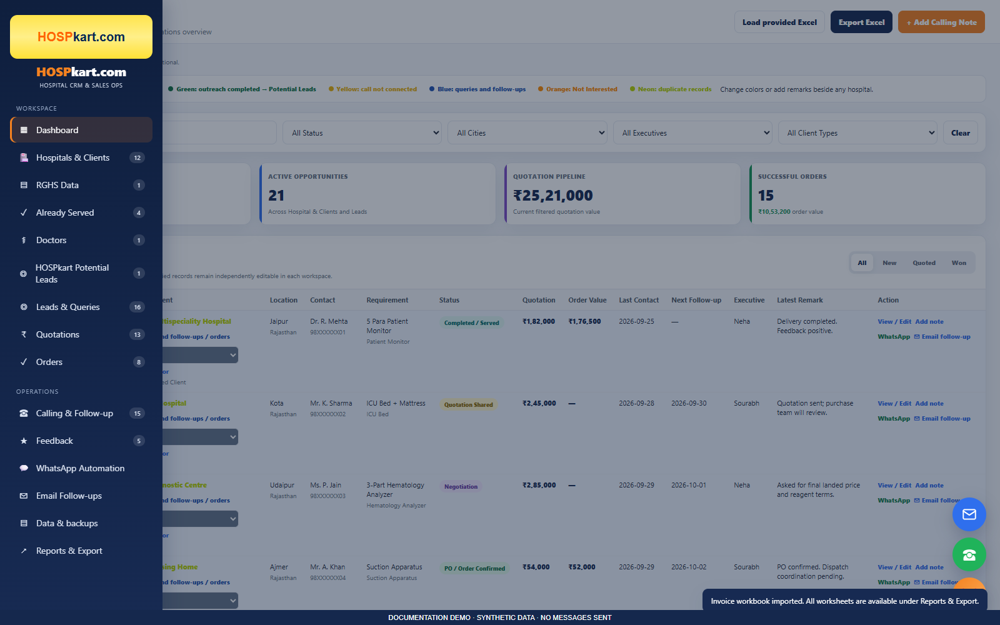

**Read this screen:** the three-line button opens the workspace menu. The yellow `HOSPkart.com` wordmark and `HOSPITAL CRM & SALES OPS` subtitle identify the application. Each workspace opens as its own page. Dashboard deliberately combines records from the six independent CRM stores; other pages focus on their own workflows.

| Page | Primary purpose | Data relationship |
|---|---|---|
| Dashboard | Combined overview, search and filter | Six workspace stores combined, without deduplicating records |
| Hospitals & Clients | Hospital/customer master | Independent client store |
| RGHS Data | RGHS-related records | Independent RGHS store |
| Already Served | Every imported service/invoice item entry | Independent served store; distinguish entries from distinct clients |
| Doctors | Doctor/contact records | Independent doctor store |
| HOSPkart Potential Leads | Qualified outreach targets | Independent potential store; may include linked copies |
| Leads & Queries | Lead stages and requirements | Independent lead store |
| Quotations | CRM quotation values and status | View over clients and leads with quotation values |
| Orders | Commercial progress and completed business | View over qualifying clients and leads; includes quotation-stage records |
| Calling & Follow-up | Due queue and call history | All-workspace follow-up records plus call notes |
| Feedback | Post-business feedback | Eligible clients/leads plus saved feedback |
| WhatsApp Automation | Draft, handoff, API/template scheduling | Browser client context plus backend messaging history |
| Email Follow-ups | Recipient preview, sending/scheduling history | Client email data plus backend SMTP jobs |
| Reports & Export | Operational downloads and invoice workbook analysis | Export views and imported workbook sheets |
| Data & backups | Checkpoints, scoped removal and reset | Browser stores, snapshots and relevant backend history |

## Dashboard and metric definitions

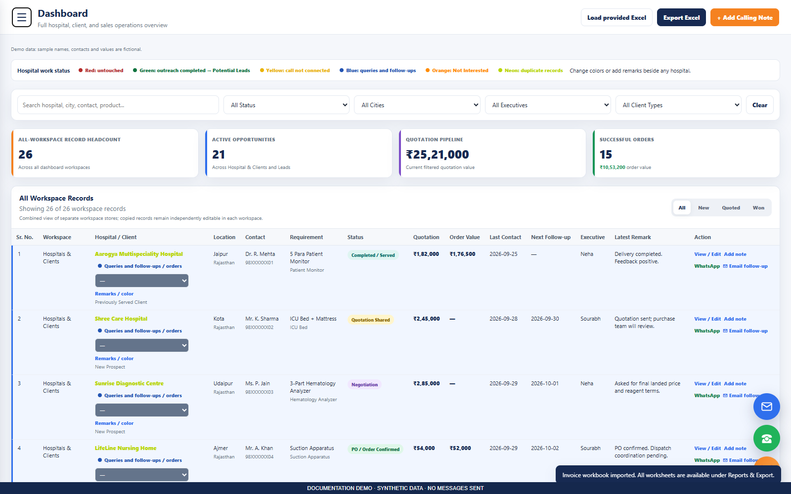

Search hospital, contact, location, product or requirement. Filter by status, city, executive and client type. The table shows each record's workspace so that a copied hospital can be identified and edited in the correct store.

| Label | Meaning | Interpretation rule |
|---|---|---|
| All-Workspace Record Headcount | Sum of the records across all six workspace stores | Full total remains unchanged when table filters change; not a unique-customer count |
| Showing X of Y | Matching records versus the full combined record total | Use X to describe the current filter result |
| Active Opportunities | Current filtered records whose status is not in the implementation's terminal/excluded set | Can include independent copies; not distinct commercial deals |
| Quotation Pipeline | Sum of nonzero quotation values in the filtered combined scope | Record-based; cross-workspace copies can repeat a value |
| Successful Orders | Filtered records matching the application's won/completed status logic | Do not equate this count to distinct invoices |
| Order Value | Recorded order values for the qualifying filtered records | Operational CRM value, not an audited revenue ledger |

Independent copies are intentional. A hospital in both Hospitals & Clients and Leads can count twice in the all-workspace headcount. Editing one copy does not synchronize all copies. Neon highlighting flags a matching record identity; it does not prove a duplicate invoice or a data error.

### Work status colors

| Color | Meaning | Action / behavior |
|---|---|---|
| Red | Untouched | Initial outreach remains to be done |
| Green | Outreach completed | Eligible source records can create a linked Potential Leads copy; source is retained |
| Yellow | Call not connected | Record the unsuccessful attempt and next action |
| Blue | Query, follow-up or order | Add a meaningful remark; this color requires a remark |
| Orange | Not Interested | Identify accounts that do not want the current offering |
| Neon | Duplicate records | Matching records across workspace stores are highlighted, including a neon legend dot |

Manual work colors remain until Automatic is selected. Automatic colors consider recorded business stages and contact history. Opening WhatsApp, drafting a message or queuing an email does not by itself prove successful outreach.

## Workspace walkthrough

### Hospitals & Clients

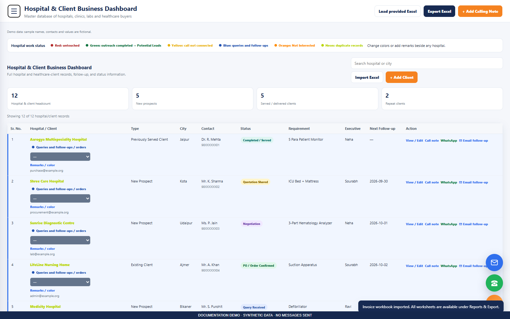

The master list contains name, client type, city/state, contact person, mobile/email, requirement/product, status, quotation/order values, last contact, next follow-up, executive, remark and priority. Use View / Edit for an existing record, Add Hospital / Client for a new record, and Import Excel for a supplied list. Preserve the correct workspace when editing a record displayed on Dashboard.

### RGHS Data

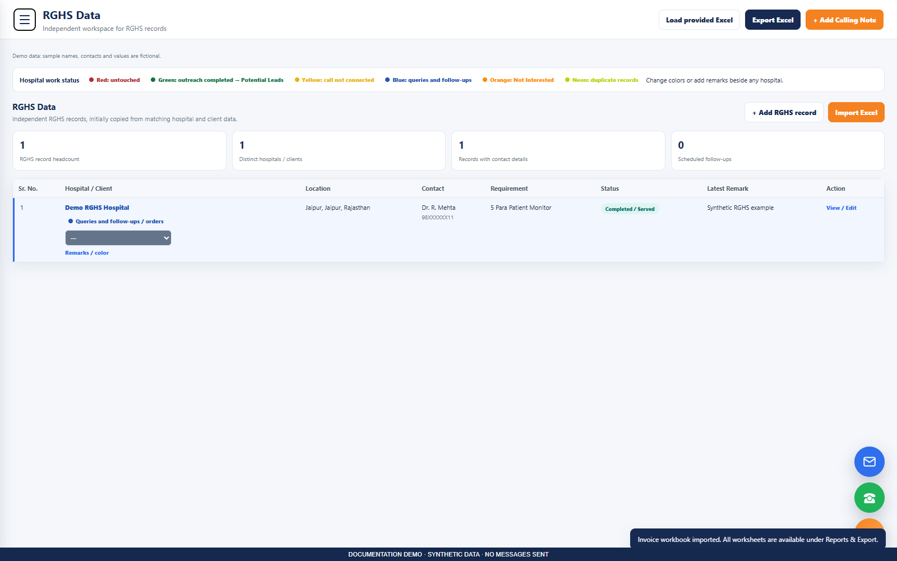

Maintain RGHS records separately from the master. Legacy matching RGHS records may be copied on initial migration; the master originals remain. Later edits stay local to the selected workspace. A RGHS classification is a recorded CRM label, not independent verification of scheme eligibility.

### Already Served

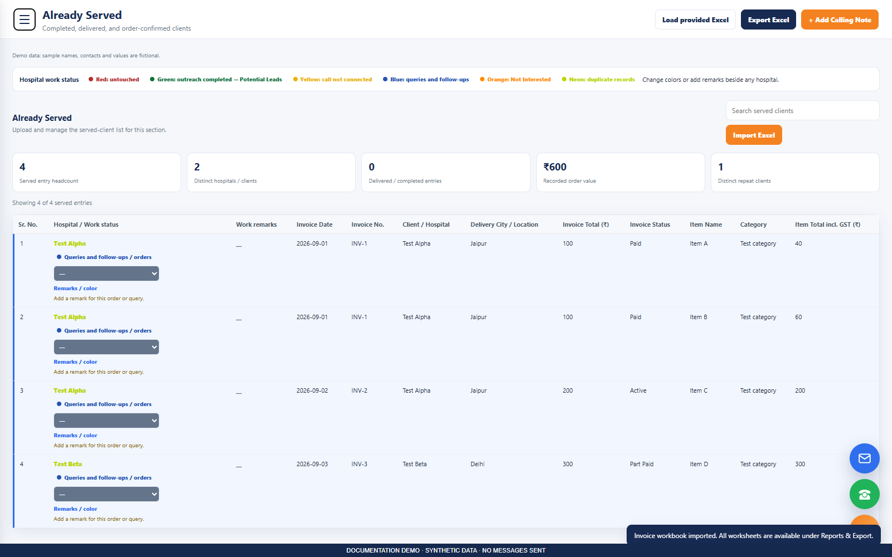

This workspace retains each `Client Call List` data row, including repeated hospitals and invoices. For the synthetic workbook, there are **4 served item entries**, **2 distinct clients**, **3 non-cancelled invoices** and **₹600 invoice value**. Two item rows belong to the same first invoice, so summing a repeated invoice total per item would be wrong.

In an actual workbook, a figure such as **38 distinct clients** must not be described as 38 service rows or 38 invoices. Always quote the metric label and current source. Headers are not client entries. Payment status alone does not prove delivery completion.

### Doctors

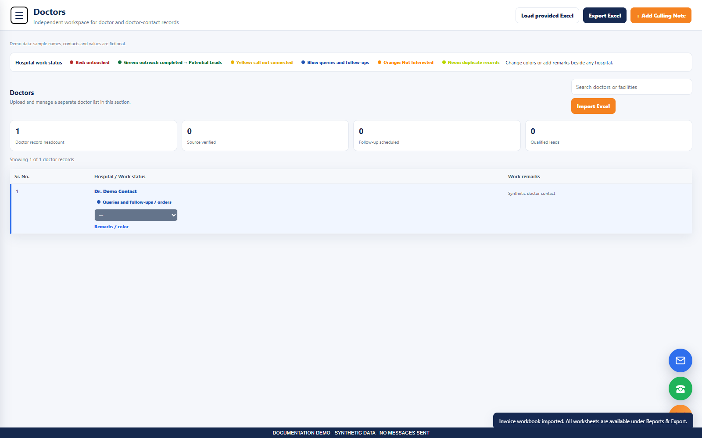

Import and manage doctor/contact lists as an independent store. Search the list, record requirements and contact remarks, and keep the healthcare contact's business context clear. This is contact management, not a medical decision or prescribing tool.

### HOSPkart Potential Leads

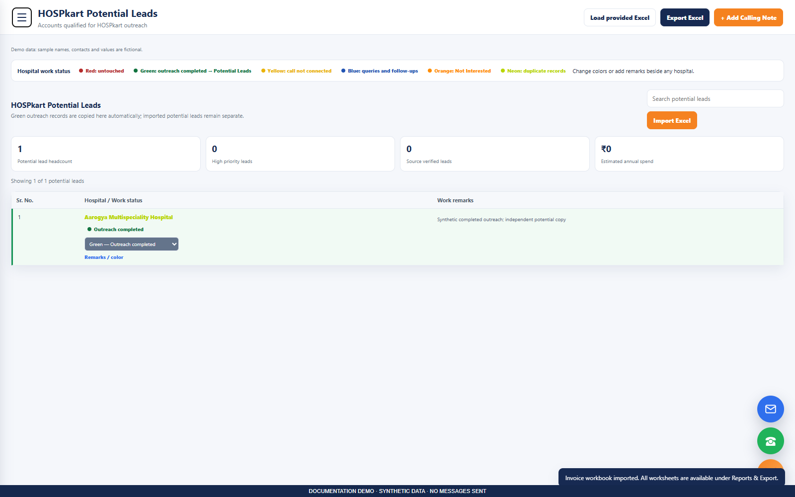

This page holds qualified outreach records. Green completion can create a linked potential copy from an eligible source. The copy stays independently editable; its source is retained, and the same source should not repeatedly create identical potential copies.

### Leads & Queries

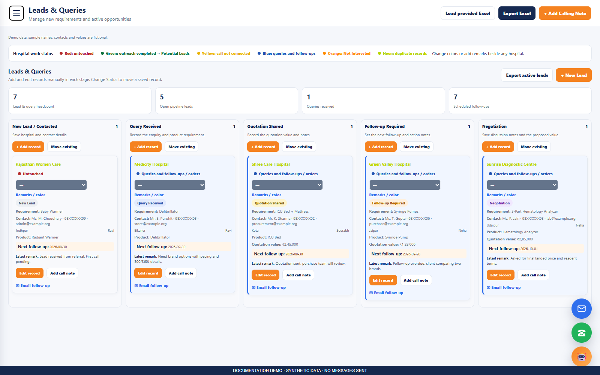

Manage New Lead / Contacted, Query Received, Quotation Shared, Follow-up Required and Negotiation. Use Add record to enter a new hospital in a stage, Edit record to update a card, or Move existing to change an existing lead's stage. Save a requirement, quotation value, next follow-up date and clear remark. The lead store remains separate from the client master.

### Quotations


The page displays clients and leads with positive quotation values, along with pipeline total, negotiation and qualifying won counts. These are CRM entries. A QuoteSaarthi draft is not automatically inserted here; review it and update the intended CRM record through its normal controls.

### Orders

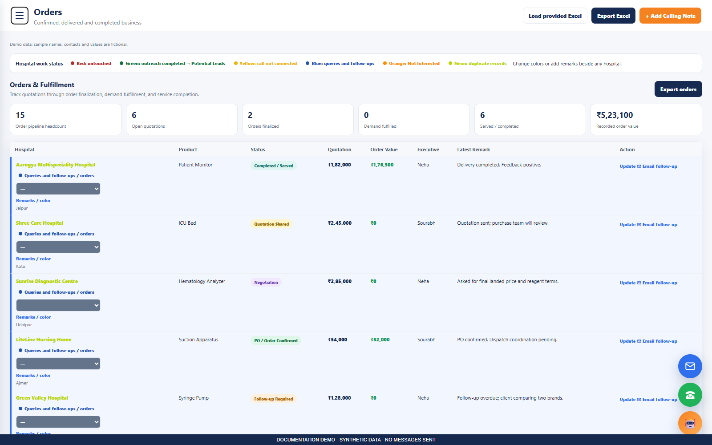

Review quotation-stage, finalized, fulfilled and served business records. This page includes some records that have not yet become confirmed orders. Read each status before describing the whole table as confirmed business. Recorded order value and invoice/payment value are separate concepts.

## Calling, feedback and messaging

### Calling & Follow-up

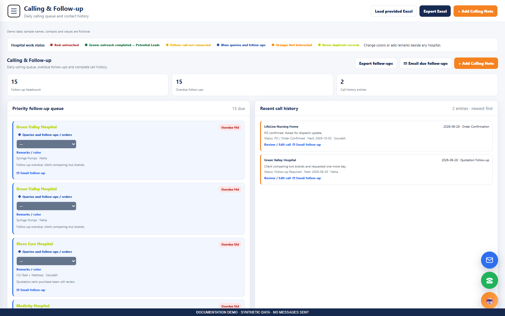

Review records with a next follow-up date, overdue items and call-history entries. Add a calling note with date, purpose, connected/not connected, interest, status, next follow-up date, notes, remarks and executive. Record a new attempt rather than overwriting history. Date-driven overdue counts can change as time passes.

### Customer feedback

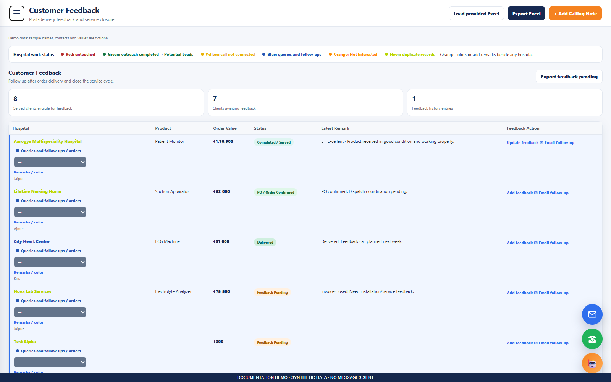

Review eligible completed/won client and lead records, identify missing feedback, and save feedback date, rating, customer text and internal remark. Existing eligible-record counts may include independent client/lead copies; do not interpret them as distinct hospital counts without checking identities.

### WhatsApp Automation

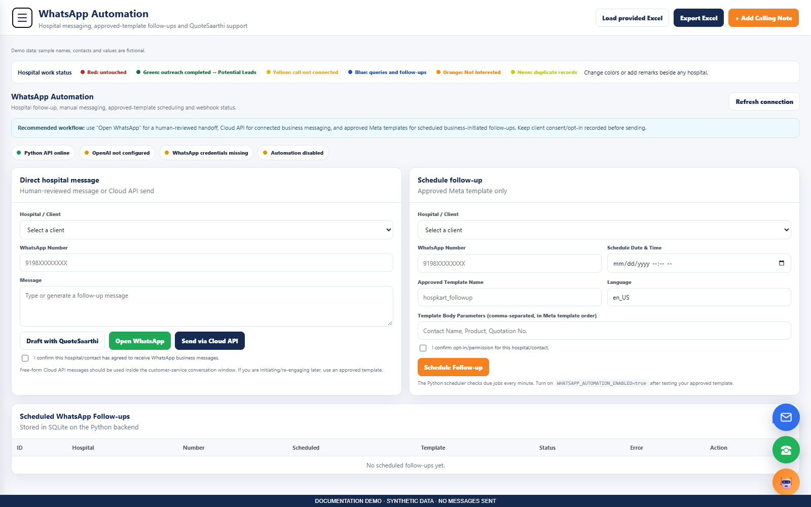

Select a record, review the destination number and prepare a message. QuoteSaarthi can draft a CRM follow-up through the optional OpenAI helper. Open WhatsApp creates a handoff for the user to review. Sending through the Cloud API requires private Meta configuration. Scheduling uses approved templates and recorded consent; the automation switch must be enabled.

The screenshot demonstrates the interface with integrations disabled. No delivery or successful live Meta integration is implied. Configure the Graph API version supported by the actual Meta app. Review the provider's current messaging requirements before enabling live sending.

### Email Follow-ups

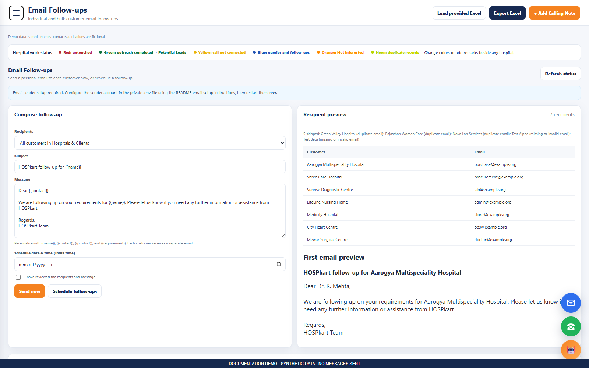

Choose recipients and purpose, personalize the subject/body with `{{name}}`, `{{contact}}`, `{{product}}` and `{{requirement}}`, then review the recipient preview. Sending or scheduling requires explicit recipient/message confirmation and SMTP configuration. Schedule inputs use India time.

History distinguishes pending, sending, accepted, failed and cancelled. **Accepted means SMTP accepted the message, not proof of delivery.** This implementation does not track opens, bounces or replies. Failed jobs need review before a replacement is created; jobs interrupted while sending are not automatically replayed as successful deliveries.

## Excel import and invoice reporting

### Import workflow

1. Open the workspace that should own the imported records, or Reports & Export for invoice analysis.
2. Choose Import Excel and select the workbook.
3. If the hospital-name header is not recognized, choose the worksheet, header row and correct name column in the mapping dialog.
4. Review an import confirmation when the application presents one.
5. Verify rows, names, values and scope after the import; retain the original file.
6. Prepare a JSON checkpoint before moving browsers, changing site addresses or clearing browser storage.

For a local invoice workbook, `prepare_invoice_workbook.py` prepares the private server snapshot used by Load provided Excel. This workbook is not distributed in the public repository.

### Operational exports

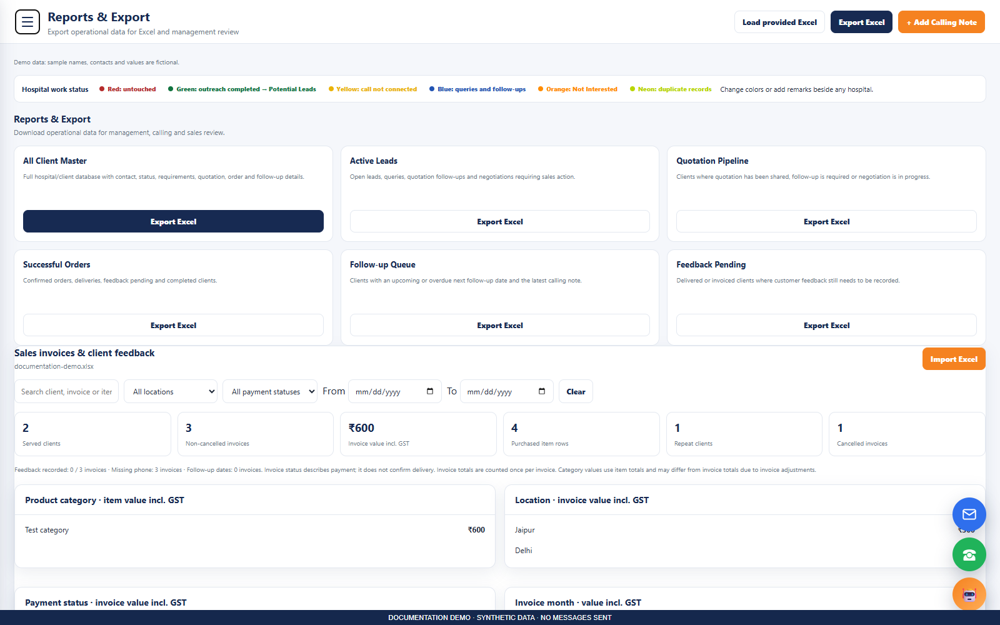

Export client master, active leads, quotation pipeline, successful-order records, follow-up queue or feedback-pending data. Export scope differs by preset; review the resulting columns and filters. Exports are operational reports, not formal financial statements.

### Invoice dashboard

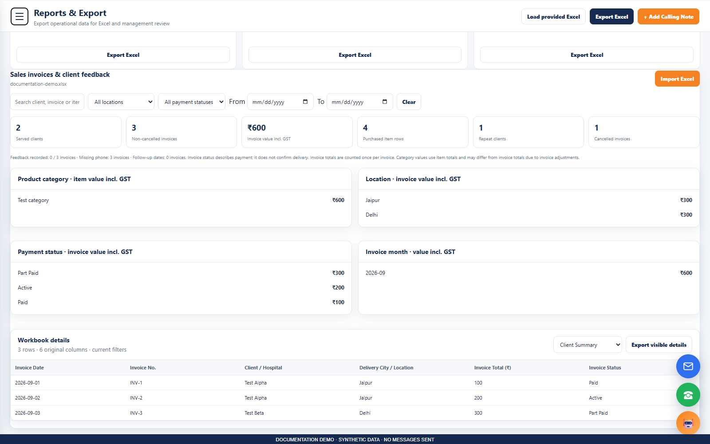

Invoice analysis lives under **Reports & Export**, while Dashboard remains the combined CRM overview. The renderer prefers `Client Summary` as invoice source, or falls back to `Client Call List` if necessary. It identifies invoice keys, counts each invoice once and excludes cancellation statuses from valid invoice totals. Separate cancelled-invoice information remains available.

| Invoice measure | Meaning |
|---|---|
| Served clients | Distinct clients represented in the current valid invoice scope |
| Non-cancelled invoices | Unique valid invoice keys |
| Invoice value incl. GST | Invoice totals counted once per invoice |
| Purchased item rows | Item-level rows, which can repeat a client or invoice |
| Repeat clients | Clients associated with more than one invoice in the relevant scope |
| Cancelled invoices | Cancellation records; kept separate from valid totals |
| Category chart | Item-level values grouped by product category |
| Location, payment and month charts | Invoice-level values grouped by their corresponding fields |

Category sums can differ from invoice sums if there are invoice-level adjustments or missing item values. The UI reports missing-phone/follow-up/feedback information. Filters allow client/item search, location, payment status and date range.

### Original workbook details

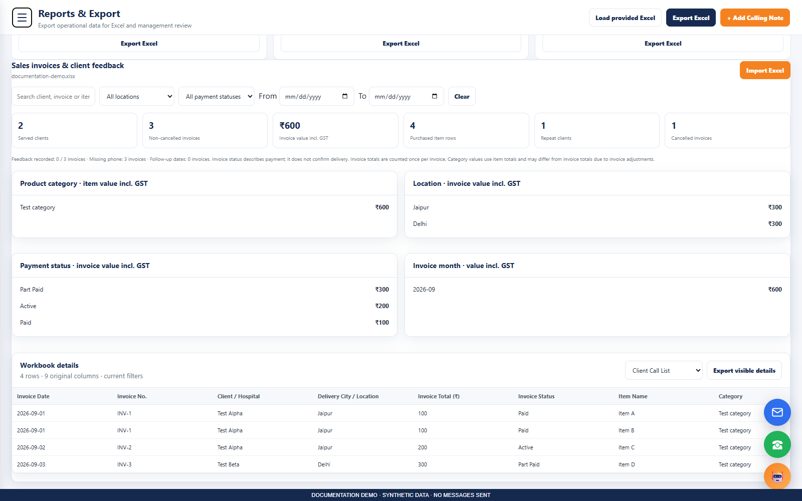

Select a worksheet to inspect original columns and rows. Keep the difference between a worksheet's raw row count and its analytical invoice/client grain explicit. Export visible details for the currently selected detail view. Removing a source worksheet can change dependent metrics.

## Backups and admin removal

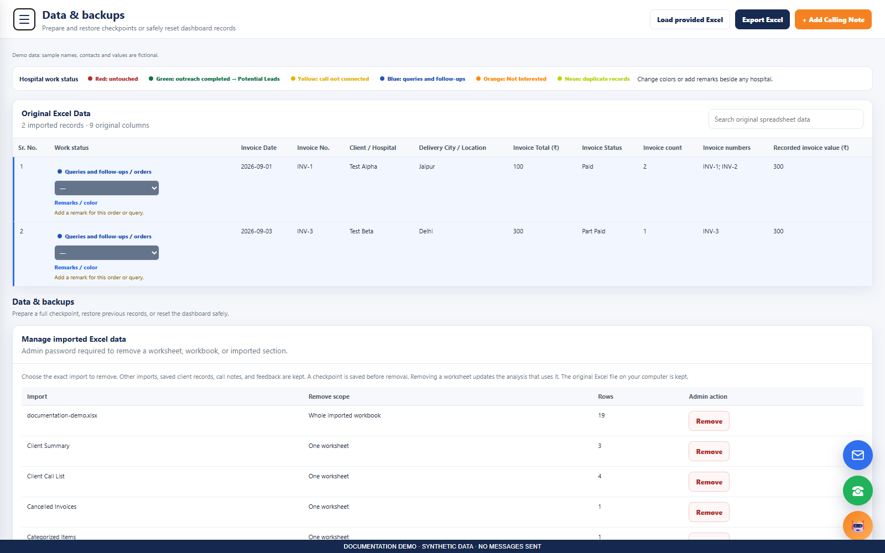

Prepare full data backup downloads a JSON checkpoint containing clients, calls, feedback, independent workspace sections and invoice workbook sheets. Restore JSON checkpoint transfers that data into another browser/profile/site origin. Browser checkpoint retention adapts to storage availability, up to the application's configured recent-history limit. Downloaded files remain independently available.

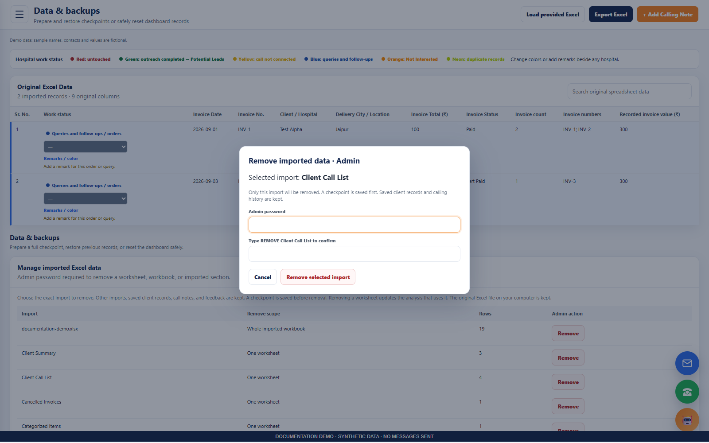

To remove one imported worksheet:

1. Open Data & backups → Manage imported Excel data.
2. Choose Remove beside the exact worksheet, workbook or imported section.
3. Check the selected import name and removal scope.
4. Enter the configured admin password and the displayed `REMOVE …` confirmation.
5. Submit only after reviewing the target. A checkpoint is saved first; unrelated imports, call notes and feedback are preserved.
6. Confirm affected metrics, then keep or restore the safety checkpoint as appropriate.

Configure a password with `set_admin_password.py` or a private `ADMIN_PASSWORD_HASH`. The admin password protects these application removal controls; it is not a complete user-login or access-control system. The screenshot shows the confirmation dialog only: no deletion was submitted.

**Full reset is a different action.** It requires acknowledging deletion and typing `RESET DASHBOARD`. It removes browser records/checkpoints and relevant server messaging history without creating a backup. Previously downloaded files and messages already sent cannot be recalled. Do not use full reset as the normal way to remove one sheet or clean a live training session.

## QuoteSaarthi

### Local catalogue search and vendor comparison

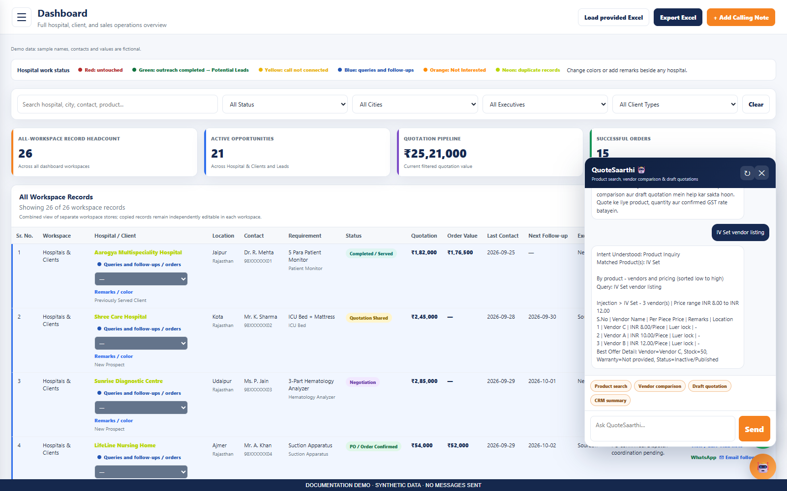

The floating assistant replaces the earlier HOSPkart SmartBot. By default it uses the handover's CSV catalogue through local keyword/entity search. Product search and draft quotation arithmetic do not require an OpenAI key, a downloaded model or a vector database. The documentation screenshot uses four synthetic offers; real vendor prices are not published here.

Example requests:

```text
IV Set ki vendor listing low-to-high pricing mein dikhao
Syringe 3 ml ka vendor-wise price comparison do
IV Set active vendors aur in-stock options dikhao
Quote IV Set 10 units with 5% discount and GST 18%
```

Review status and stock as well as price. The cheapest offer in an unrestricted catalogue search is not automatically an available/active approved vendor. Use the active/in-stock filter when that constraint matters. Catalogue records may need refresh before a procurement decision.

### Draft quotation and downloads

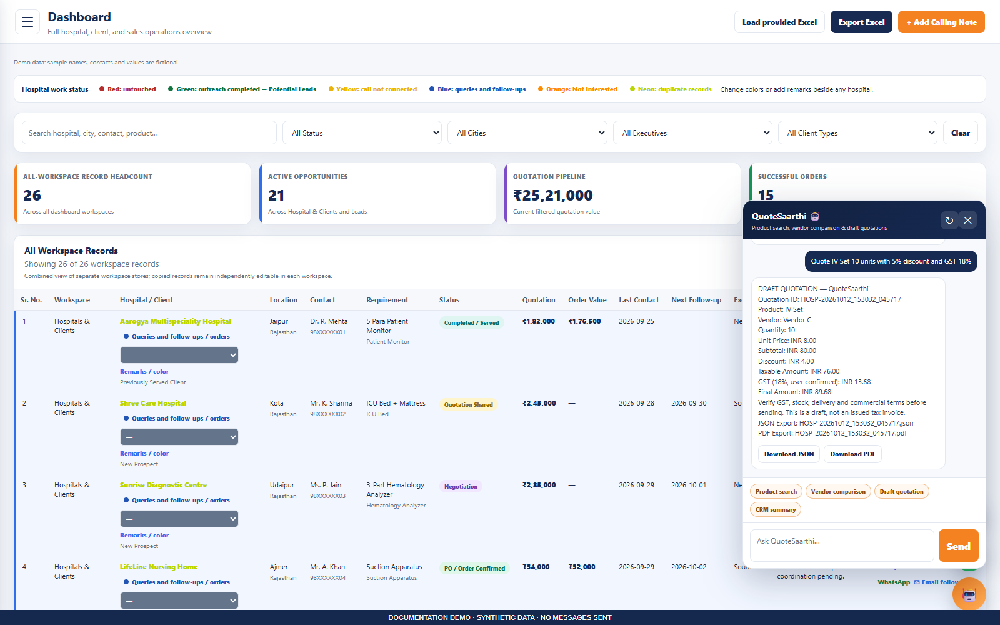

The bot requires quantity and a confirmed GST rate for a fresh quote. It asks for clarification when information is missing or invalid. It does not assume the previous product's quantity or tax rate for a new quote. One product is supported per draft; send separate requests for multiple products.

Synthetic calculation shown in the screenshot:

| Calculation | Amount |
|---|---:|
| 10 units × ₹8.00 catalogue unit price | ₹80.00 |
| 5% discount | ₹4.00 |
| Taxable amount | ₹76.00 |
| 18% user-confirmed GST | ₹13.68 |
| Final draft amount | **₹89.68** |

Amounts use decimal arithmetic and cent rounding. The tax percentage here is a test input, not advice about the actual product's tax classification. Downloads contain draft JSON/PDF, not issued tax invoices. They do not create CRM quotations/orders automatically. Review tax, vendor, stock, delivery and commercial terms before sharing.

Chat state is isolated per conversation token and kept separately from CRM records. New conversation clears the selection/chat context, not the dashboard. Sessions expire after two hours of inactivity or server restart; download access is scoped to the generating conversation. The optional OpenAI CRM helper receives bounded dashboard context, while optional Ollama formatting remains disabled by default. The project has not fine-tuned an AI model.

## Architecture and data ownership

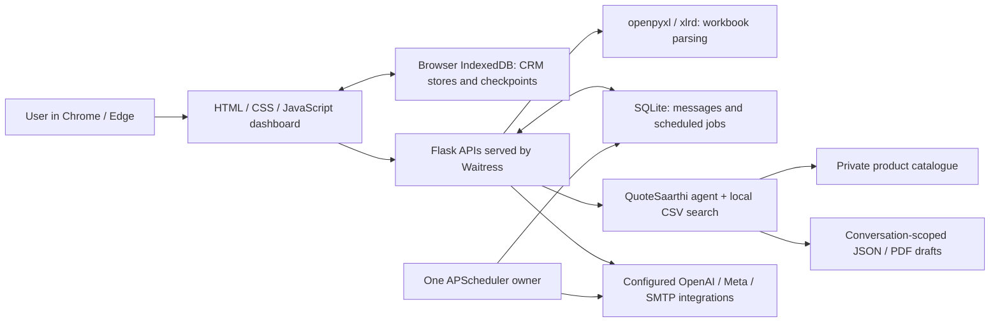

| Component | Implementation / responsibility |
|---|---|
| Web UI | `templates/index.html` and `static/` scripts/styles; no required frontend build pipeline |
| Backend | `app.py`, Flask routes and input checks |
| Production entry | `production.py`, Waitress; Windows/Linux scripts available |
| CRM persistence | Browser IndexedDB; legacy localStorage copied and verified before old values are removed |
| Import transaction | Import and safety checkpoint saved together; failed writes preserve previous state |
| Messaging persistence | SQLite in private `CRM_DATA_DIR` |
| Scheduling | APScheduler, one scheduler-owning process |
| Invoice parsing | openpyxl/xlrd; private prepared workbook helper |
| Catalogue / agent | `quotesaarthi/rag.py`, `agent.py`, `runtime.py`; pandas CSV search |
| PDF draft rendering | ReportLab |
| Automated checks | unittest; Playwright Chrome/Edge locally and Chromium in CI |

Browser data is scoped to browser profile and site origin. Chrome and Edge do not automatically share CRM records. `localhost:5000` and `127.0.0.1:5000` also have separate browser data. JSON backup/restore is the current transfer mechanism. A persistent server disk protects server files; it does not turn browser CRM stores into a shared database.

## Setup and production operation

### Local setup

```powershell
python -m venv .venv
.venv\Scripts\python.exe -m pip install -r requirements.txt
Copy-Item .env.example .env
.venv\Scripts\python.exe production.py
```

Open the server address, for example `http://127.0.0.1:5000/`, and keep using that same address for the same saved browser data. Do not open `templates/index.html` through a static Live Server expecting Python APIs to work.

For the supplied private catalogue:

```powershell
.venv\Scripts\python.exe prepare_quotesaarthi_catalog.py "C:\path\HospKart-BD-Chatbot-IT-Handover.zip"
.venv\Scripts\python.exe set_admin_password.py
```

Restart after changing catalogue/environment configuration. The public repository does not include the private product CSV, customer workbook, passwords, conversation logs or generated customer documents.

### Configuration groups

| Group | Configuration | Required for |
|---|---|---|
| Core server | `HOST`, `PORT`, `FLASK_DEBUG=false`, persistent `CRM_DATA_DIR` | Python hosting and durable server files |
| Catalogue | `QUOTESAARTHI_CATALOG_PATH` or default private CSV path | Product/vendor search and quotes |
| Optional formatter | `QUOTESAARTHI_USE_OLLAMA=false` by default; model setting | Optional local-model wording; separate package/service needed |
| Optional CRM AI | `OPENAI_API_KEY`, `OPENAI_MODEL` | CRM summaries and AI message drafts |
| Meta | Private access token, phone-number ID, verify token, supported API version | WhatsApp API and webhook workflows |
| SMTP | Host, port, security, username/password and sender | Email sending/scheduling |
| Admin | Private hash or locally configured admin password | Scoped removal authorization |
| Scheduler | `SCHEDULER_ENABLED`; messaging automation switches | Scheduled follow-up processing |
| HTTPS proxy | `TRUSTED_PROXY`, `TRUSTED_PROXY_COUNT` | Trust forwarded HTTPS origin only from actual proxy |

Use a Python-capable host. Static-only GitHub Pages cannot execute Flask APIs. Run debug mode off, provide private persistent server storage and configure HTTPS/proxy handling. Keep exactly one scheduler owner to avoid repeated scheduled-job execution. Multiple-user production requires additional identity, authorization and shared data design before claiming collaborative CRM behavior.

## Testing, training and troubleshooting

### Mobile overview and navigation

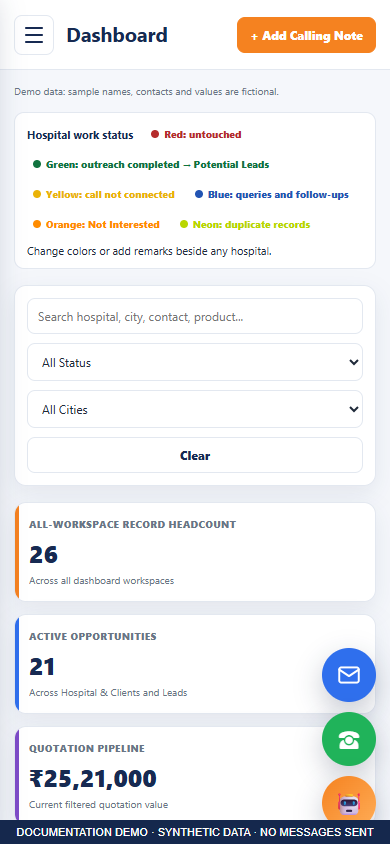

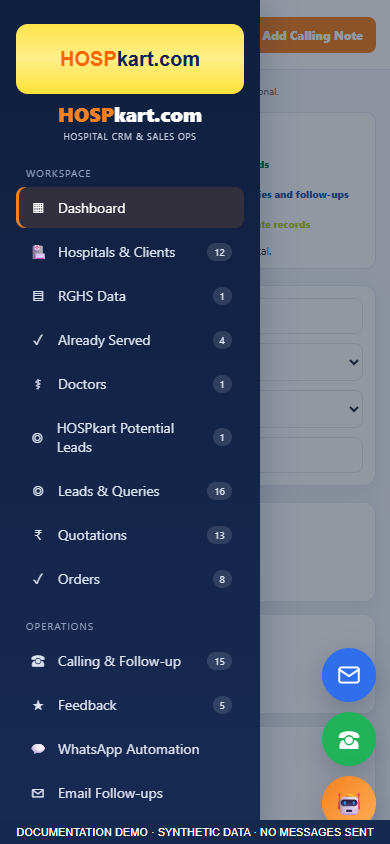

Use the same menu to switch workspaces on a phone-size viewport. Wide operational tables may require horizontal scrolling; desktop is preferable for reviewing many original Excel columns. Mobile views use the same browser-origin storage rules and do not imply device-to-device synchronization.

### Verification commands

```powershell
.venv\Scripts\python.exe -m pip install -r requirements-dev.txt
.venv\Scripts\python.exe -m unittest discover -s tests
.venv\Scripts\python.exe tests/check_production_browsers.py
.venv\Scripts\python.exe tests/check_quotesaarthi.py
```

The documented QuoteSaarthi integration verification had **58 passing backend tests**, actual Chrome/Edge checks and a successful GitHub Actions run. These are engineering verification results, not an uptime guarantee. Tests cover imports, capacity/migration, rollback, corrupt/blocked storage, browser transfer, mobile navigation, admin removal, chat state, GST validation, calculations and export access. Private-workbook checks have separate local input requirements; use the instructions in README.md.

For this guide, screenshot capture completed with no browser page errors and real local search/draft rendering against the synthetic catalogue. It did not test live OpenAI, SMTP or Meta delivery.

### Suggested 45-minute team training

| Time | Activity | Completion check |
|---|---|---|
| 5 min | Navigation, metric labels and work colors | Explain records versus unique clients |
| 8 min | Search/edit a fictional client and lead | Update the intended workspace copy |
| 7 min | Record a call and follow-up date | Call history contains the new attempt |
| 7 min | Import a synthetic invoice workbook | Reconcile 4 entries / 2 clients / 3 invoices / ₹600 |
| 8 min | Search catalogue; create/download draft | Verify ₹89.68 example arithmetic and draft label |
| 5 min | Backup, restore and scoped removal explanation | Distinguish removal from permanent reset |
| 5 min | Review messaging previews | Explain sending prerequisites and accepted-versus-delivered |

Use a separate practice profile and temporary backend for destructive exercises. Do not send messages or reset the live dashboard as a training cleanup action.

| Symptom | Likely cause / next action |
|---|---|
| Chrome appears empty while Edge has records | Separate browser storage; transfer with full JSON backup/restore |
| Different data at localhost and 127.0.0.1 | Different site origins; use the original address or restore a checkpoint |
| Import fails or storage warning appears | Browser storage blocked, corrupt or disk-limited; download recovery checkpoint and follow visible warning |
| Sheet headers not detected | Use the worksheet/header/name-column mapping dialog |
| Served count differs from unique-client count | Repeated invoice/item rows; inspect labels and invoice grouping |
| Catalogue unavailable | Prepare the private CSV on this host and restart; public Git does not include products |
| Quote asks for GST/quantity | Intended clarification; provide verified values |
| Old conversation/download expires | Start a new conversation and regenerate the draft |
| CRM summary not configured | Configure optional OpenAI credentials, or use local product/quote features |
| Email or WhatsApp unavailable | Configure provider credentials and review integration health; do not repeatedly click Send |
| Logo or legend looks stale | Reload the served application with Ctrl + Shift + R |

## Limitations and proposed improvements

**Implemented:** independent browser stores, combined dashboard, work colors/duplicate highlighting, transactional imports, invoice analysis, checkpoints, admin-protected scoped removal, local catalogue assistant, draft downloads, provider-dependent messaging controls and automated tests.

**Requires configuration:** private catalogue/workbook, admin password, OpenAI for CRM AI, Meta for WhatsApp, SMTP for email, persistent hosting and HTTPS/proxy setup. Screenshots do not prove these external services are live.

**Proposed future work, not delivered features:** shared server-side CRM database, user login and per-role authorization, audited change history, multi-product RFQ/quotation documents, live catalogue/stock refresh, stronger duplicate reconciliation, delivery tracking and automated multi-user synchronization. Business time savings or ROI require a measured pilot; no improvement percentages are established by this code.

## Screenshot inventory and presentation instructions

All paths are relative to this repository. Use the full-size PNGs in slides; crop around the discussed feature while retaining the synthetic-data label or adding an equivalent caption. Avoid showing invented production metrics.

| Screenshot | What to explain |
|---|---|
| `01-navigation.png` | Yellow branding and full workspace menu |
| `02-dashboard.png` | Combined overview and filtering |
| `03-clients.png` | Hospital/client master |
| `04-rghs.png` | RGHS workspace |
| `05-served.png` | Entries versus distinct clients |
| `06-doctors.png` | Doctor-contact management |
| `07-potential.png` | Qualified potential copies |
| `08-leads.png` | Lead stages |
| `09-quotations.png` | CRM quotation values |
| `10-orders.png` | Commercial stages |
| `11-calling.png` | Due queue and call history |
| `12-feedback.png` | Customer feedback |
| `13-whatsapp.png` | Draft and provider controls |
| `14-email.png` | Recipient/message preview |
| `15-reports.png` | Operational export presets |
| `16-invoice-analysis.png` | Invoice metrics and charts |
| `17-workbook-details.png` | Original worksheet rows/columns |
| `18-backups.png` | Checkpoints, transfer and management |
| `19-admin-removal.png` | One-sheet admin confirmation |
| `20-quotesaarthi-search.png` | Local vendor search |
| `21-quotesaarthi-draft.png` | Quote arithmetic and exports |
| `22-mobile.png` | Mobile overview |
| `23-mobile-navigation.png` | Mobile navigation |

The screenshot [manifest](docs/screenshots/manifest.json) records data provenance and fixture values. To recreate the screenshots after UI changes:

```powershell
.venv\Scripts\python.exe docs/capture_project_screenshots.py
```

It starts a temporary Waitress server, disables external integrations/scheduling, creates synthetic files, uses a new browser context and closes the temporary server after capture. `DOC_BROWSER=chromium` selects installed Playwright Chromium instead of Chrome.

For PPT generation, provide this guide, [the detailed presentation prompt](PPT_GENERATION_PROMPT.md), and `docs/screenshots/` together. The prompt specifies slide content, image selection, speaker notes, technical diagrams and claim boundaries.
